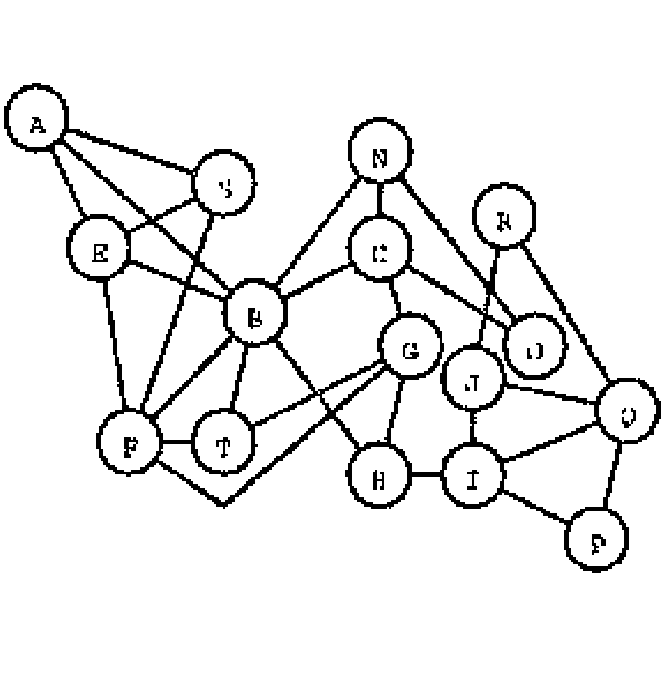
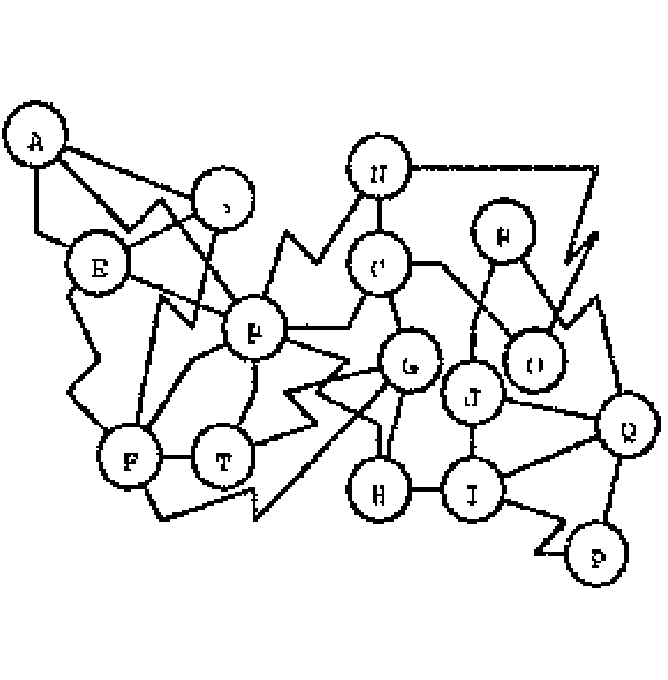
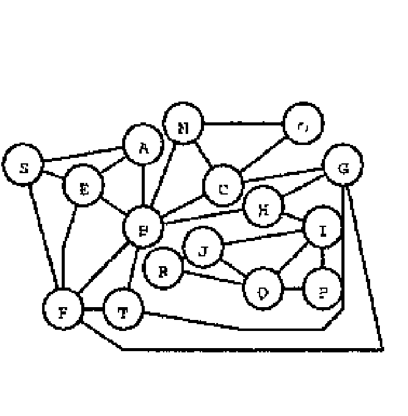
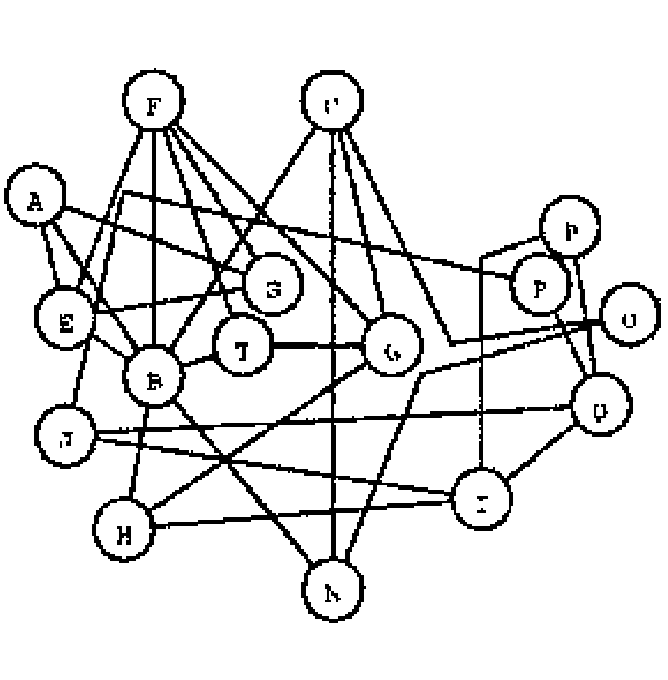
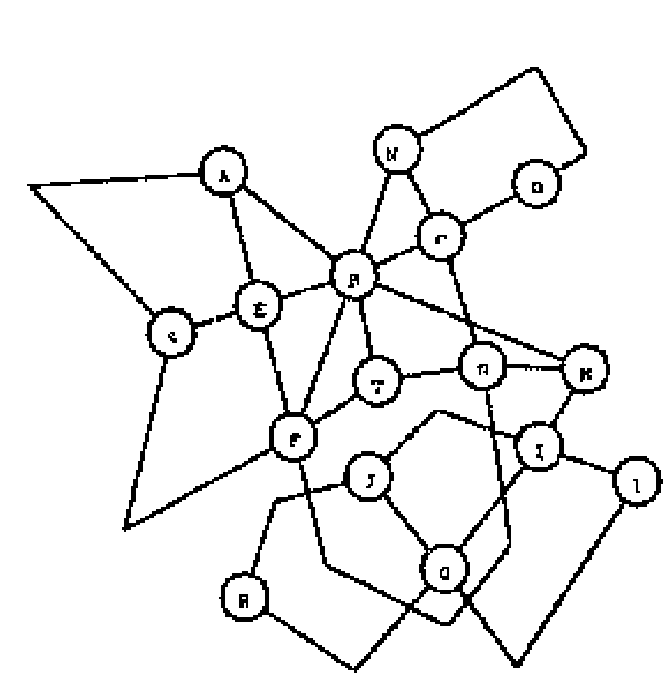
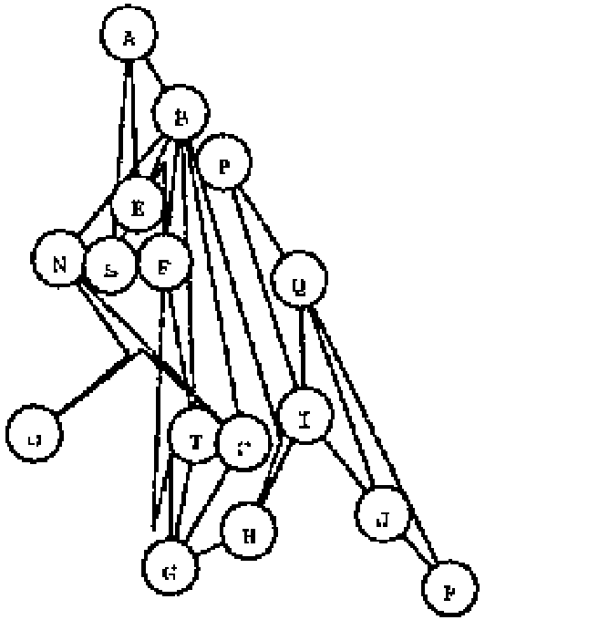
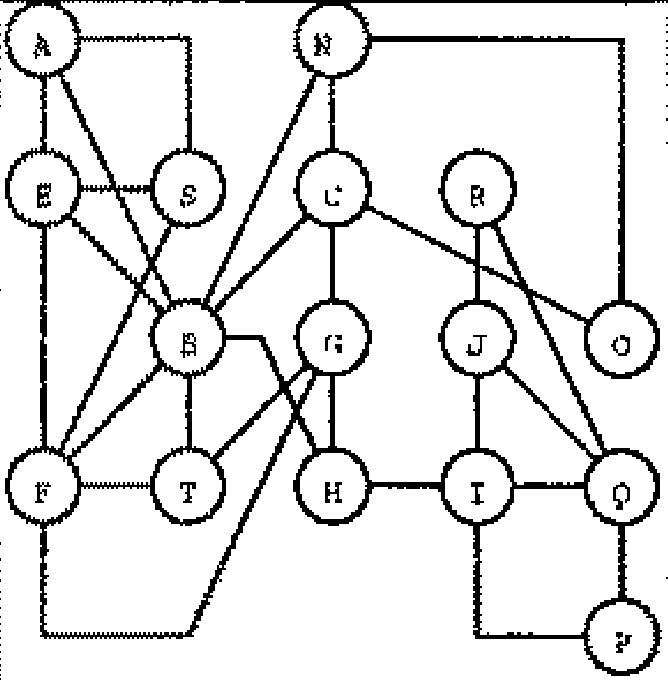
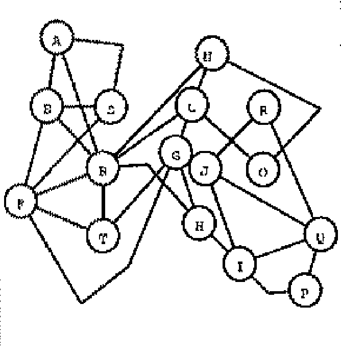
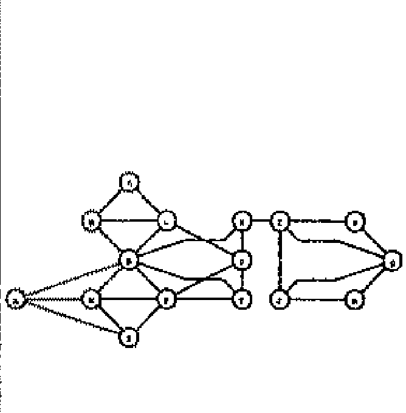
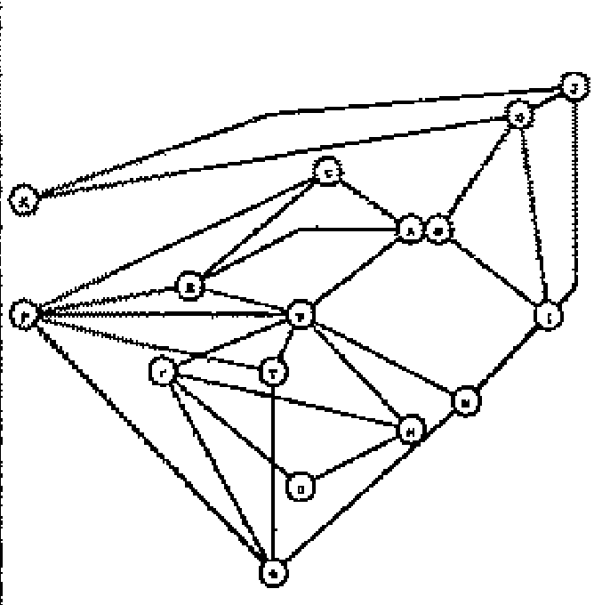

# Graph Screenshots

This subdirectory contains screenshots of the graphs from the original paper.

The screenshots are named after the corresponding graph in the paper, where

- B is for bend-less
- C is for cross-less
- M is for minimum angle
- O is for orthogonality
- S is for symmetry

In the paper the graphs are all presented in tables with their respective
properties. Unfortunately, we were unable to obtain any high-resolution PDFs
or scans of the paper; the paper only exists as a low-resolution scan online.

This directory contains screenshots of the graphs from the paper taken zoomed 
in to the maximum extent possible. Each screenshot was taken at the same 
resolution and zoom level, so the relative sizes of the graphs as presented in 
the paper are preserved.

As you will see, the original node labels are not always legible.
We can probably assume that the nodes were all equally sized in the original
experiment, but scaled down to fit into the table columns. This is why the
nodes are not always the same size in the screenshots.

## Experimental Graphs Table

This table is a reaction from the original paper.
It shows the "aesthetic values" of the graphs.

| | Graph | bend-less | cross-less | minimum angle | orthogonality | symmetry |
|----|-------|-----------|------------|---------------|---------------|----------|
| b+ |    | 0.96 | 0.97 | 0.38 | 0.27 | 0.75 |
| b- |  | 0.47 | 0.99 | 0.44 | 0.28 | 0.71 |
| c+ |    | 0.82 | 1    | 0.46 | 0.33 | 0.63 |
| c- |  | 0.87 | 0.88 | 0.35 | 0.29 | 0.84 |
| m+ |    | 0.71 | 0.98 | 0.62 | 0.22 | 0.74 |
| m- |  | 0.82 | 0.98 | 0.16 | 0.26 | 0.79 |
| o+ |    | 0.82 | 0.98 | 0.42 | 0.46 | 0.73 |
| o- |  | 0.82 | 0.98 | 0.41 | 0.21 | 0.68 |
| s+ |    | 0.77 | 0.99 | 0.57 | 0.29 | 0.96 |
| s- |  | 0.87 | 0.99 | 0.44 | 0.25 | 0.00 |

