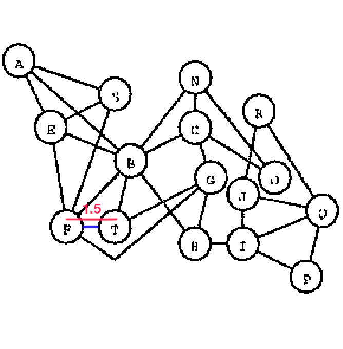

# Purchase Dataset Recreation

This subdirectory contains the Python code using NetworkX to recreate the graphs from

Purchase, Helen. "Which aesthetic has the greatest effect on human understanding?." International symposium on graph drawing. Berlin, Heidelberg: Springer Berlin Heidelberg, 1997.

The original dataset is not available, so the graphs are recreated using the images in the paper.

## Graph Definition Files

The other BPlus, BMinus, CPlus, etc. files define the graphs from the paper as instances of the PurchaseGraph class. For instance, `PurchaseBPlus.py` contains the programatic definition of the b+ graph from the paper.

The graph definition files can be imported into other Python scripts to use the graphs in NetworkX.

Alternatively, you can run the graph definition files directly to get a single graph visualization and print the graph JSON to the console.

### Defining the recreation metrics

As the dataset is not available, but for the low-resolution images in the paper, we do our best attempt to eyeball the graph and recreate it as closely as possible.

We have decided on the following.
The distance between the nodes are set as follows:
- In the example graph b+, the distance between the nodes F and T is 1.5 units. All other distances are set relative to this distance. Nodes this close also appear in other graphs, so we are using this as a reference across all graphs. (Shown red is the 1.5 unit distance between node centers, the blue line shows the resulting line length)
- We are only using distances and positions in 0.5 steps. This appears to be the step size used in the original graphs.

## Functionality Files

`PurchaseGraph.py`: Contains the PurchaseGraph class to recreate the graphs from the paper. NetworkX does not allow edges with bends, so we have implemented that functionality in the PurchaseGraph class. Additionally, it contains style information to recreate the aesthetics of the original graphs, as well as
functions to visualize and export the graphs to exchangable files.

We store the graphs in a JSON format, which is compatible with
d3.js according to the documentation at https://networkx.org/documentation/stable/reference/readwrite/json_graph.html.

`generateGraphJson.py`: Exports the graphs to appropriatly named JSON files.

`importGraphJson.py`: Contains a function to import a graph JSON file generated by our code and visualize the graph. 

