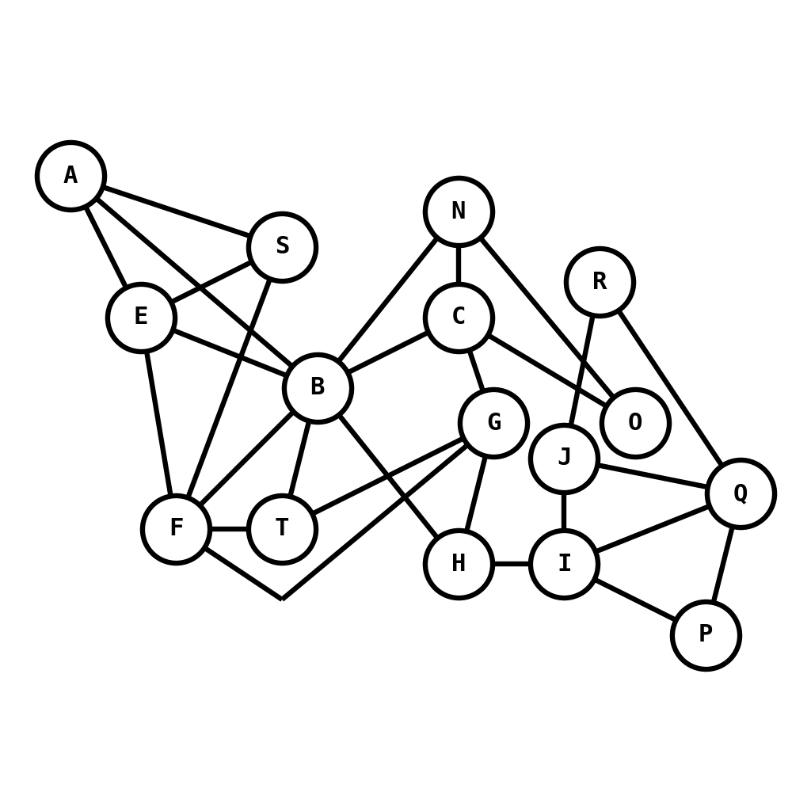
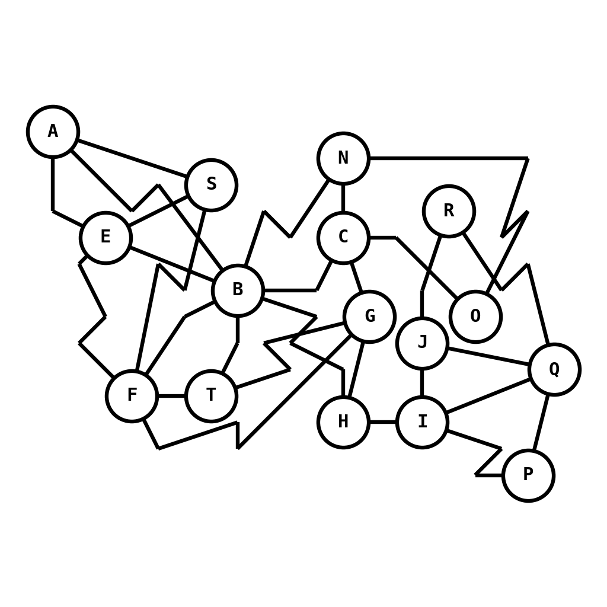
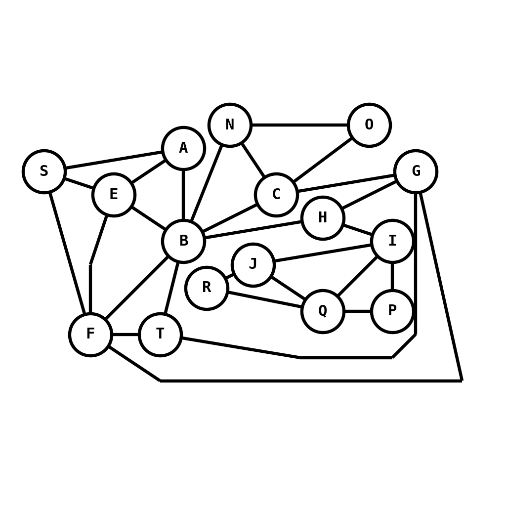
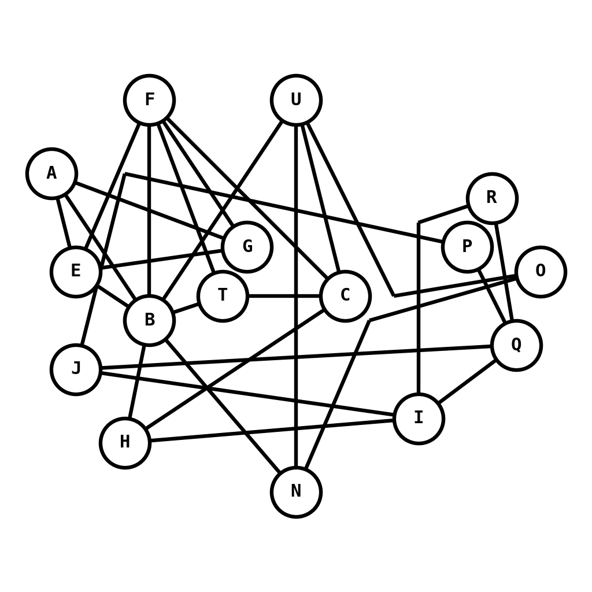
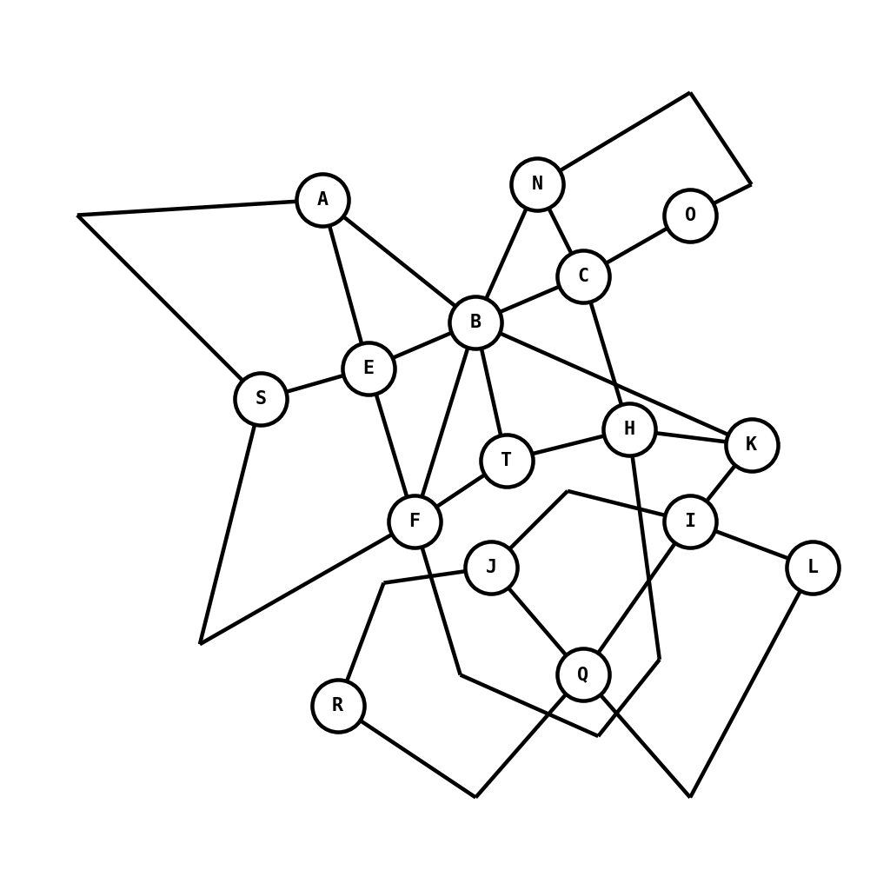
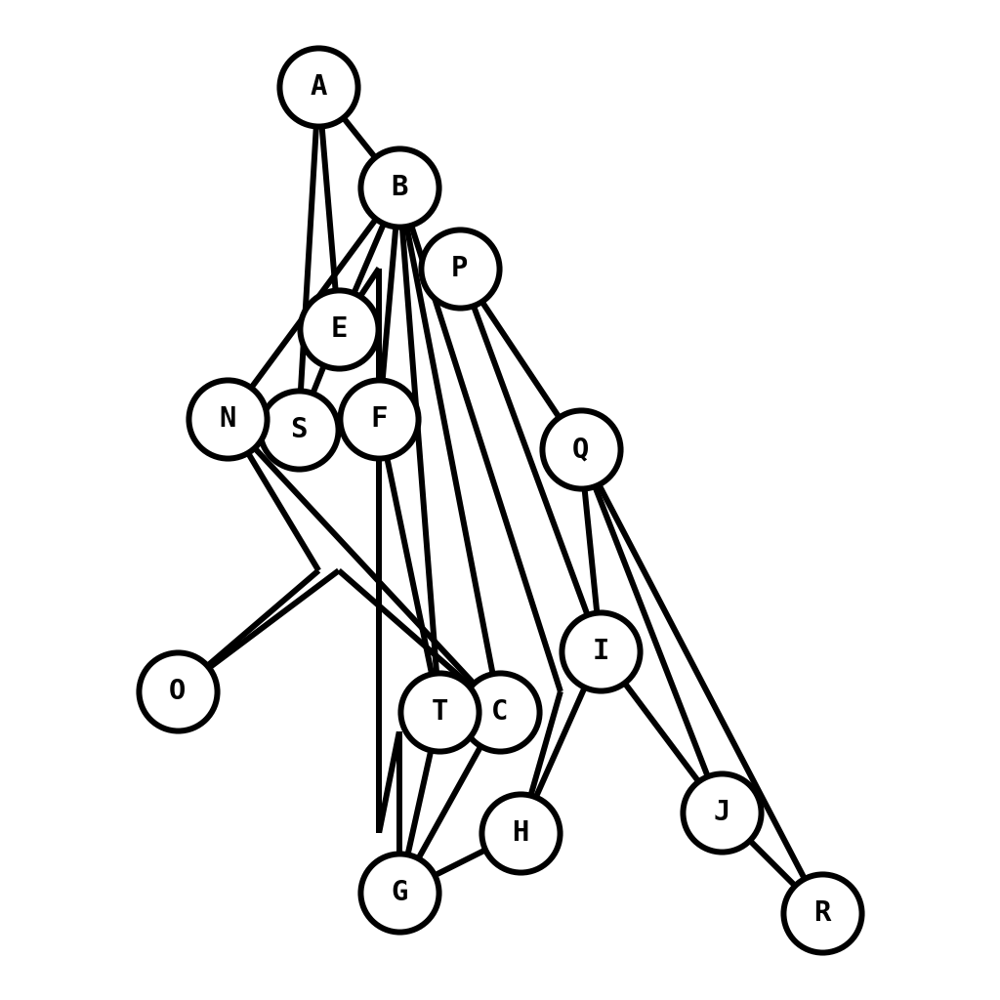
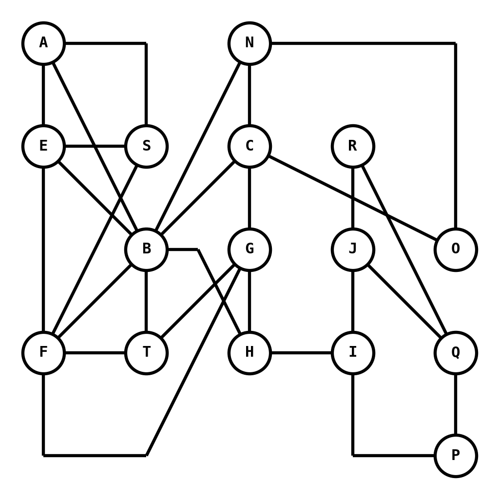
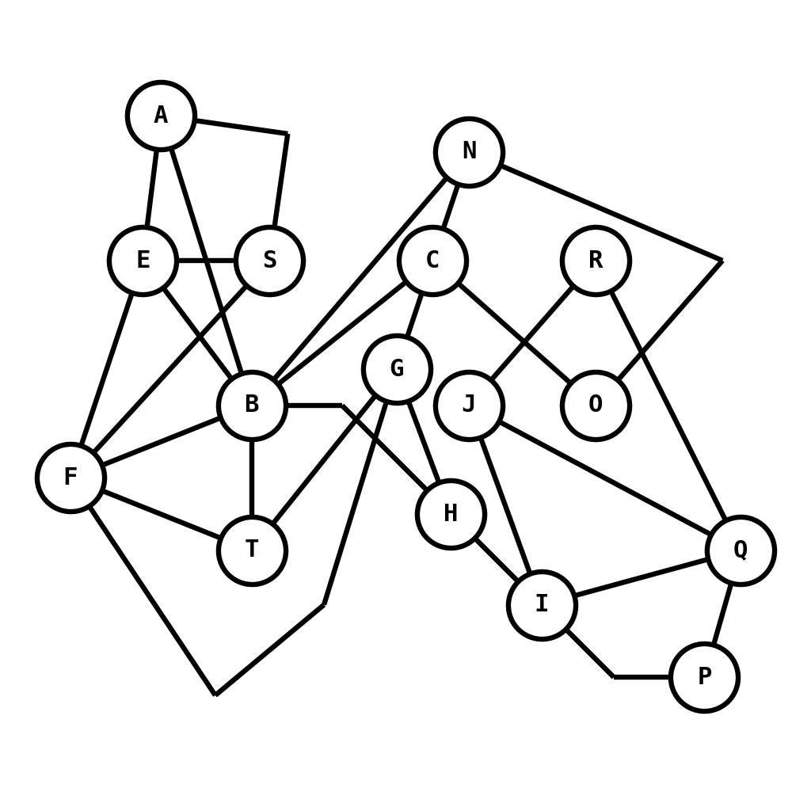
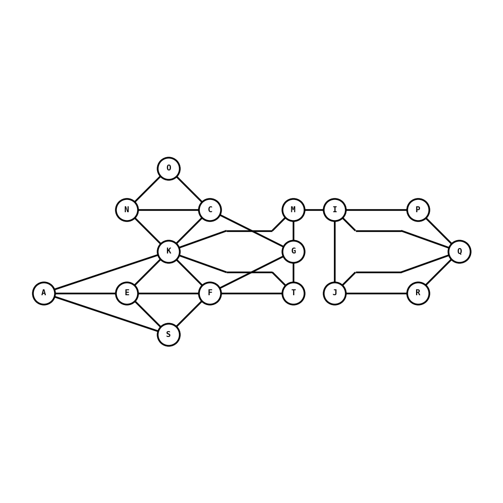
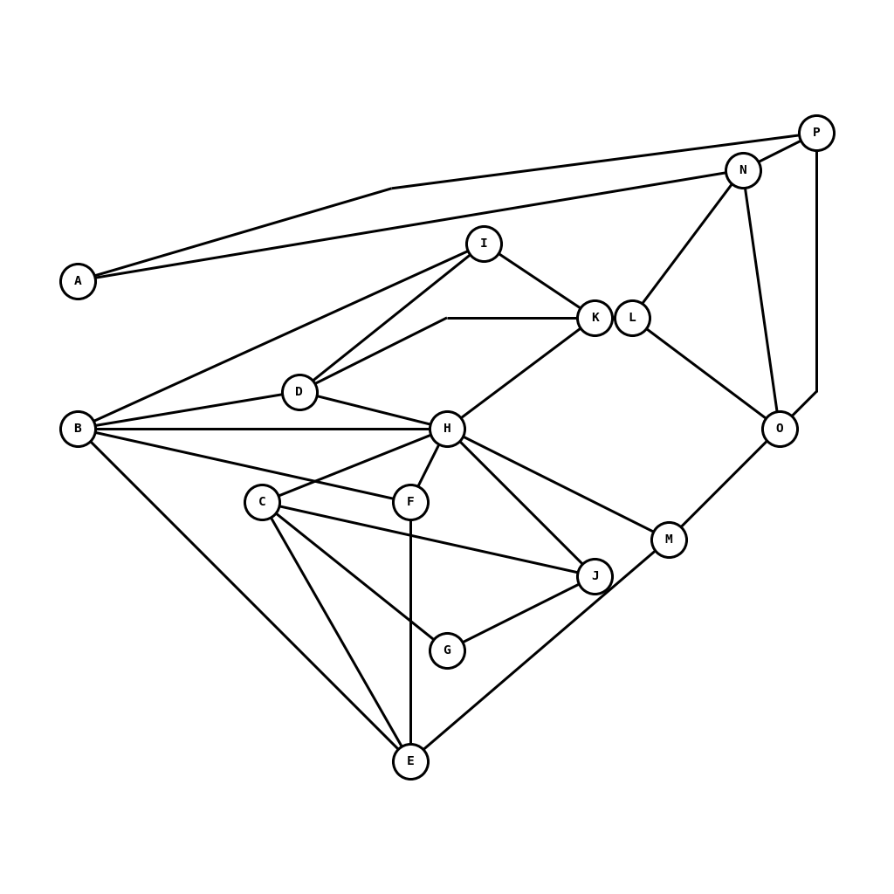

# Recreated graph images from the original paper

|     | Graph         | bend-less | cross-less | minimum angle | orthogonality | symmetry |
| --- | ------------- | --------- | ---------- | ------------- | ------------- | -------- |
| b+  |  | 0.96      | 0.97       | 0.38          | 0.27          | 0.75     |
| b-  |  | 0.47      | 0.99       | 0.44          | 0.28          | 0.71     |
| c+  |  | 0.82      | 1          | 0.46          | 0.33          | 0.63     |
| c-  |  | 0.87      | 0.88       | 0.35          | 0.29          | 0.84     |
| m+  |  | 0.71      | 0.98       | 0.62          | 0.22          | 0.74     |
| m-  |  | 0.82      | 0.98       | 0.16          | 0.26          | 0.79     |
| o+  |  | 0.82      | 0.98       | 0.42          | 0.46          | 0.73     |
| o-  |  | 0.82      | 0.98       | 0.41          | 0.21          | 0.68     |
| s+  |  | 0.77      | 0.99       | 0.57          | 0.29          | 0.96     |
| s-  |  | 0.87      | 0.99       | 0.44          | 0.25          | 0.00     |
